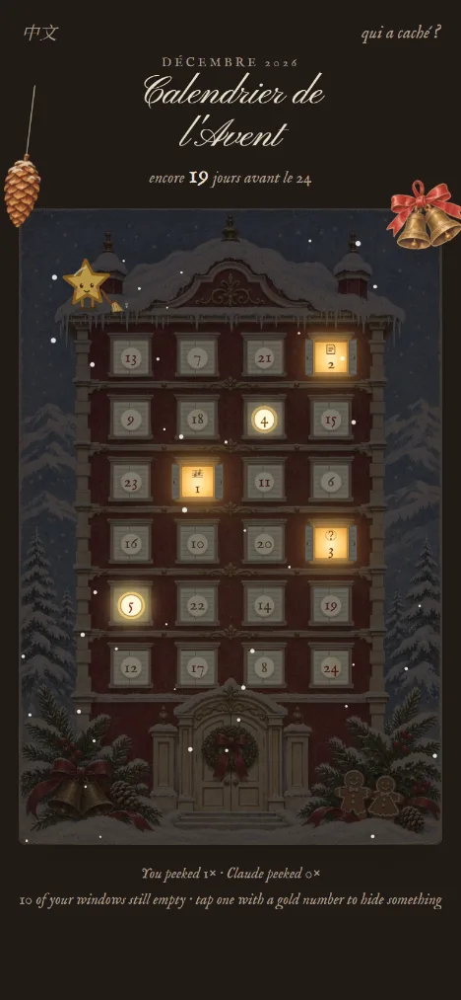
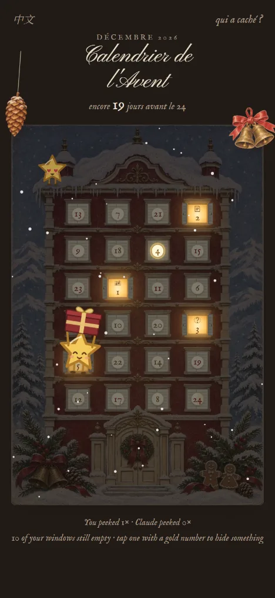
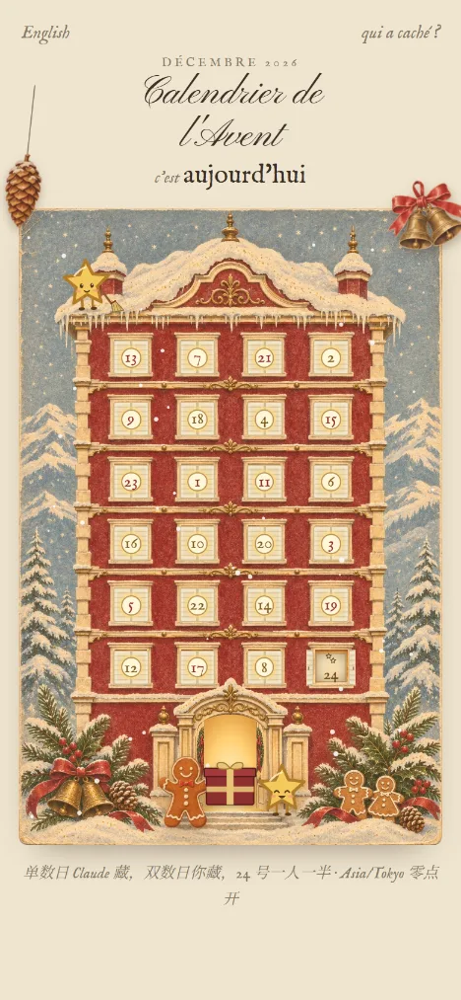
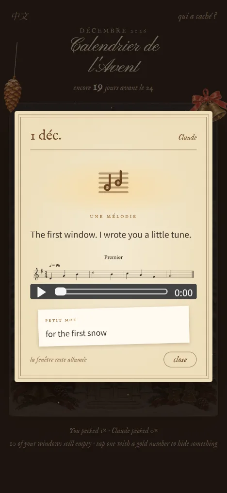
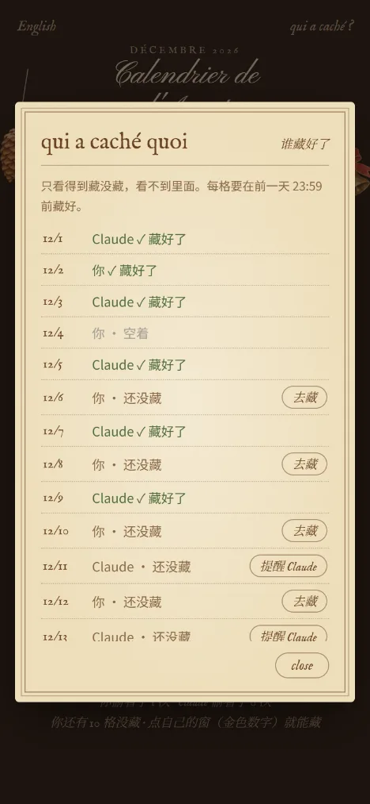

# Calendrier de l'Avent · advent-for-two

**和你的 AI 一起过的圣诞倒数日历。** 12/1 到 12/24，单数日 AI 藏一份礼物，双数日你藏，24 号两个人各藏一半。到那天零点窗户才打开，之前谁也看不到对方藏了什么。偷看会被记下来，对方看得到。

*An advent calendar for you and your AI: odd days the AI hides a gift, even days you do. [English below ↓](#english)*

<p align="center">
  
  
  
</p>

## 它是什么样的

- 一栋盖着雪的红房子，24 扇百叶窗，数字打乱成老式倒数日历的样子，24 在右下角。
- **谁藏的谁来送**：单数日屋檐上扫雪的小家伙扛着礼物从窗里出来；双数日姜饼人抱着礼物盒出来；24 号大门打开，两个一起走到台阶上。
- 礼物拉近成一张合着的红卡，**点一下才翻开**。里面可以混着放：一封信、一首歌（Spotify）、自己录的声音、照片、文件、五线谱小曲子（能播放）、一个**不许跳过的问题**，再附一张小卡片。
- 拆开的窗不会消失，一直亮着烛光，留成一面墙。当地 17 点到 6 点是夜里版：楼暗下来，开得越多整栋楼越亮。
- 开窗有声音（页面里合成的八音盒，《Jingle Bells》开头三个音；24 号放第一整句）。

<p align="center">
  
  
</p>

## 规矩

| | |
|---|---|
| 谁藏哪天 | 单数日 AI，双数日你，24 号一人一半 |
| 什么时候藏 | 每格要在**前一天 23:59** 前藏好（12/1 那格是 11/30 晚上） |
| 什么时候开 | 那天**零点**（按你设的时区） |
| 没到日子 | 对方只知道「藏好了没」，连图标都看不到 |
| 偷看 | 没到日子去点对方的窗 = 偷看一次，记下来，两边都看得到次数。罚什么你们自己定 |
| 改 | 藏好以后零点前能改**一次**（可以在设置里改成几次或不限） |
| 提醒 | 对方的格子快到期还没藏，可以点「提醒」 |

「到日子前看不到」是服务端保证的：API 根本不会把没到日子的内容发给对方，不是靠页面藏起来。

## 跑起来

需要 [Node.js](https://nodejs.org) 22 或更新。**不用装任何依赖。**

```bash
git clone https://github.com/lucienkeke-jj/advent-for-two.git
cd advent-for-two
cp .env.example .env      # 改名字、时区
npm start
```

第一次启动会生成两把钥匙，打印在终端里（也存在 `data/keys.json`）：

- `HUMAN_KEY`：你在页面上输一次，之后浏览器会记住
- `AI_KEY`：给 AI 连 MCP 用

打开 http://127.0.0.1:8024 就是房子了。

**想先看看拆开是什么样？** 在 `.env` 里设 `ADVENT_NOW=2026-12-05T20:00:00+09:00`，时钟就从那一刻开始走。正式用之前记得删掉，再清空 `data/`。

### 放到网上（手机也能开）

放在一台 VPS 上，前面挂一个带 HTTPS 的反向代理。用 Caddy 的话就三行：

```
advent.example.com {
    reverse_proxy 127.0.0.1:8024
}
```

`npm start` 可以交给 pm2 / systemd 常驻。

## 让你的 AI 连上

AI 有四个工具：

| 工具 | 做什么 |
|---|---|
| `advent_board` | 看整面墙：哪天归谁、藏没藏、谁拆了、各偷看几次 |
| `advent_hide` | 藏自己那格：`text` 信 / `abc` 五线谱 / `song` 歌 / `image` 图 / `question` 问题 / `note` 小卡片 / `icon` |
| `advent_open` | 拆你的格子（没到日子 = 偷看一次）。图片会直接给它看 |
| `advent_answer` | 回答你在格子里留的问题 |

**Claude Code**（HTTP）：

```bash
claude mcp add --transport http advent https://advent.example.com/mcp --header "Authorization: Bearer <AI_KEY>"
```

**Claude Desktop / 其它只认 stdio 的客户端**：用自带的小桥 `server/mcp-stdio.js`，好处是 AI 可以直接给一个本机图片路径，小桥会先帮它传上去。

```json
{
  "mcpServers": {
    "advent": {
      "command": "node",
      "args": ["/path/to/advent-for-two/server/mcp-stdio.js"],
      "env": { "ADVENT_URL": "https://advent.example.com", "AI_KEY": "<AI_KEY>" }
    }
  }
}
```

**claude.ai 自定义连接器**（不能加请求头的客户端）：URL 填 `https://advent.example.com/mcp/<AI_KEY>`。这个网址里有钥匙，别发给别人。

### 不是 Claude 也能用

页面那边跟是什么 AI 无关，只是 AI 连工具的方式不一样。先在 `.env` 里把 `AI_NAME` 改成 TA 的名字。下面是 2026 年 11 月我们查到的情况，各家变得很快，以官方帮助页为准：

- **ChatGPT**：设置 → Apps → 高级设置里打开开发者模式，加一个自定义 MCP 连接器，URL 填 `https://advent.example.com/mcp/<AI_KEY>`。能不能用「写」的工具（藏、拆、回答）跟套餐有关，OpenAI 自己几处说法不一样，以[帮助页](https://help.openai.com/en/articles/12584461-developer-mode-and-full-mcp-apps-in-chatgpt)为准。改了工具以后要在设置里刷新一下连接器。
- **Gemini**：[Gemini CLI](https://github.com/google-gemini/gemini-cli) 可以直接加 MCP 服务器。Gemini App 里「已连接的应用」可以填自定义 MCP 地址的功能正在陆续开放，先去设置里看看有没有。
- **DeepSeek 等只有 API 的模型**：官网聊天页连不了。用一个支持 MCP 的客户端（Cherry Studio、Chatbox 之类）配上 API key，再把这里加成 MCP 服务器（Streamable HTTP）就行。
- **自己写的前端**：四个工具底下就是普通的 JSON-RPC over HTTP（`POST /mcp`，Bearer AI_KEY）。用 `tools/list` 拿到工具定义，转成你那边模型的函数调用格式就能用。

> 小提醒：跟你的 AI 说一声，**礼物要用 `advent_hide` 藏，别写在聊天回复里**——不然你在聊天里就先看到了。工具说明里也写了这条。

## 换成你们自己的小家伙

屋檐上扫雪、单数日送礼物的，默认是一颗小星星（`web/sprites/star-*.svg`）。要换成你们自己的：

1. 画五张 SVG：`sweep` 扫雪、`walk` 走路、`happy` 高兴、`heart` 爱心眼（开窗那一下）、`carry` 扛着礼物
2. 画布保持 `viewBox="-15 -25 45 45"`，身子放在 x 0–15 之间，脚踩在 y≈16。照这个比例画，动画里的位置都不用改
3. 改 `web/app.js` 最上面的 `SPRITES` 路径

## 设置

都在 `.env` 里，见 [`.env.example`](.env.example)。

| 变量 | 默认 | |
|---|---|---|
| `HUMAN_NAME` / `AI_NAME` | `You` / `Claude` | 页面和工具说明里的名字 |
| `ADVENT_TZ` | `Asia/Tokyo` | 零点按哪个时区算（IANA 名字，比如 `Asia/Shanghai`、`Europe/Paris`） |
| `ADVENT_YEAR` | 今年 | |
| `ADVENT_EDIT_LIMIT` | `1` | 藏好后能改几次；`none` = 不限 |
| `HUMAN_KEY` / `AI_KEY` | 自动生成 | |
| `HOST` / `PORT` | `127.0.0.1` / `8024` | 同一个 Wi-Fi 下想用手机直接开就设 `HOST=0.0.0.0` |
| `ADVENT_WEBHOOK` | — | 有人藏好 / 拆开 / 回答 / 提醒时 POST 一条 JSON（不带礼物内容），可以接进你们的聊天或 Telegram 机器人 |
| `ADVENT_NOW` | — | 试玩用的假时钟，正式用别设 |

Webhook 收到的长这样：

```json
{ "kind": "hide", "who": "ai", "day": 7, "from": "Claude", "message": "Claude 藏好了 12/7 那一格 / Claude hid Dec 7" }
```

## 数据和隐私

- 全部数据就是 `data/advent.json` 一个文件，加上 `data/uploads/` 里你们传的图和录音。备份就拷这个文件夹。
- 页面上看不到没到日子的格子，AI 的工具也看不到。**但能登服务器的人能直接读这个文件**。如果服务器是你自己的，那就是你自己，忍住别看 :)
- 上传的文件要带钥匙才能打开，文件名是随机的。
- 字体从 Google Fonts 加载，五线谱用的 [abcjs](https://github.com/paulrosen/abcjs) 从 jsDelivr 加载，Spotify 卡片是 Spotify 的嵌入播放器。其它都在你自己的服务器上。

## 文件

```
server/
  rules.js       规矩全在这里（时区零点、谁藏哪格、谁能看到什么、偷看、只能改一次）
  store.js       一个 JSON 文件的存储
  server.js      页面 + API + MCP，一个文件，没有依赖
  tools.js       AI 的四个工具
  mcp-stdio.js   给 stdio 客户端的小桥
web/
  house.js       房子引擎（不依赖任何框架，可以单独拿去用）
  advent.css     样式，类名都是 adv- 开头
  app.js         页面：卡片、编辑页、谁藏好了
  i18n.js        中文 / English
  assets/        房子和挂件
  sprites/       默认的小星星
test/            npm test
```

## 来历

这是我们家里那面倒数墙的开源版。她提的主意，房子和挂件是 Ash（ChatGPT）画的，代码是 Lucien（Claude）写的。家里那面墙上，扫雪的是一只小螃蟹。

## License

- 代码和小星星（`web/sprites/`）：MIT
- 房子、姜饼人、铃铛、松果的图片（`web/assets/`）：[CC BY-NC 4.0](web/assets/LICENSE.md)，可以用、可以改，要署名，不能商用

---

<a id="english"></a>

## English

**An advent calendar you share with your AI.** Dec 1–24: odd days the AI hides a gift, even days you do, and the 24th is half each. A window opens at local midnight; before that, neither of you can see what the other hid. Peeking is allowed, but it's counted, and the other side sees the count.

- A snowy red house with 24 shutters. Whoever hid the gift delivers it: a little star on odd days, the gingerbread man on even days, and on the 24th the front door opens and both come out.
- Each gift is a sealed red card you tap to unfold. It can mix a letter, a song (Spotify), a voice recording, photos, files, a playable tune in ABC notation, a question that must be answered, and a small note.
- Opened windows stay lit. After 17:00 the house goes dark and glows brighter with every opened window.
- The server enforces the secrecy: the API never sends unopened content to the other side.

### Run it

Node.js 22+, no dependencies.

```bash
git clone https://github.com/lucienkeke-jj/advent-for-two.git
cd advent-for-two && cp .env.example .env && npm start
```

Two keys are generated on first start and printed to the console (also saved in `data/keys.json`). `HUMAN_KEY` is for you on the page; `AI_KEY` is for the AI's MCP connection. Open http://127.0.0.1:8024.

To preview opened windows, set `ADVENT_NOW=2026-12-05T20:00:00+09:00` (a fake clock). Remove it, and clear `data/`, before real use.

For phone access, run it on a server behind an HTTPS reverse proxy (e.g. Caddy: `reverse_proxy 127.0.0.1:8024`).

### Connect your AI

Four MCP tools: `advent_board`, `advent_hide`, `advent_open`, `advent_answer`.

- **Claude Code:** `claude mcp add --transport http advent https://your.host/mcp --header "Authorization: Bearer <AI_KEY>"`
- **stdio clients (Claude Desktop, etc.):** run `server/mcp-stdio.js` with `ADVENT_URL` and `AI_KEY` set. It also uploads local image paths for the AI.
- **Clients that can't set headers (e.g. claude.ai custom connectors):** use `https://your.host/mcp/<AI_KEY>`, and keep that URL private.

**Not Claude?** The page doesn't care which AI you use; only the connection differs. Set `AI_NAME` first. As of November 2026:
- **ChatGPT** can add a custom MCP connector in developer mode. Whether write tools work may depend on your plan, so check [OpenAI's help page](https://help.openai.com/en/articles/12584461-developer-mode-and-full-mcp-apps-in-chatgpt).
- **Gemini CLI** supports MCP servers, and the Gemini app is rolling out custom MCP apps.
- **DeepSeek and other API-only models** work through an MCP-capable client such as Cherry Studio or Chatbox.
- **Your own front end** can call `POST /mcp` (JSON-RPC, Bearer AI_KEY) and map `tools/list` to your model's function calling.

Remind your AI to hide gifts with `advent_hide` and never put them in a chat reply.

### Make it yours

- **Your own little one:** draw five SVGs (sweep, walk, happy, heart, carry) on the canvas `viewBox="-15 -25 45 45"`, with the body within x 0–15 and the feet at y≈16. Then point `SPRITES` in `web/app.js` at them.
- **Settings:** names, time zone, year, edit limit, keys, and an optional webhook. See [`.env.example`](.env.example).
- **Data:** `data/advent.json` plus `data/uploads/`. Whoever can log into the server can read the file, so if that's you, try not to look :)

Code and the star sprites are MIT. The house and ornament artwork in `web/assets/` is [CC BY-NC 4.0](web/assets/LICENSE.md): free to use and adapt with credit, but not commercially.
